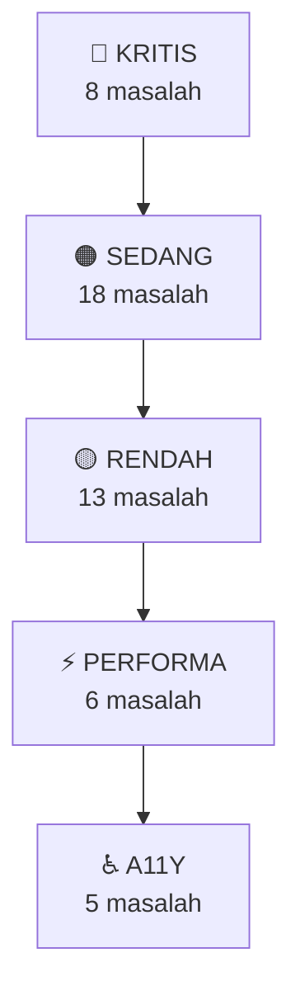

# 📋 Laporan Review Blog Kalinz

> Template Blogger **LinkMagz v3.8.0** — Blog **KALINZ | Lirik Lagu Nias & Budaya Nias**
> Diaudit: 16 Oktober 2026

---

## 1. Review Struktur Folder

```
e:\kalinz\
├── archieve/                       ← (⚠️ typo: seharusnya "archive")
│   ├── kamus-nias-indonesia-1985.pdf   (14.9 MB — arsip PDF)
│   └── template-original.xml           (365 KB — backup template awal)
├── assets/
│   ├── logo_kalinz (compress).png      (247 KB)
│   └── logo_kalinz.png                 (1.2 MB — versi asli)
├── halaman/                        ← 4 halaman statis
│   ├── disclaimer.html
│   ├── kebijakan-privasi.html
│   ├── kontak.html
│   └── tentang.html
├── postingan/                      ← 40+ artikel lirik lagu Nias
│   ├── bjbtrio-*.html              (7 file — BJB Trio)
│   ├── erickijo-*.html             (8 file — Erick Ijö)
│   ├── gauswaruwu-*.html           (1 file — Gaus Waruwu)
│   ├── tice-*.html                 (24 file — Tice)
│   └── _mengenal-lagu-nias.html    (1 file — artikel pengantar)
├── temp/                           ← file sementara & referensi
│   ├── dictionary.html                 (taksonomi genre/tema resmi)
│   ├── index-lagu.md                   (indeks daftar lagu)
│   ├── template-lirik-lagu-kalinz-v1_3.html (template standar v1.3)
│   ├── template-lirik-lagu-kalinz.html (template lama)
│   ├── temporary-fill.html
│   ├── tmp.html                        (kosong)
│   └── ts                              (file tanpa ekstensi)
├── README.md                       (2.8 KB — dokumentasi)
└── template.xml                    (387 KB — template Blogger aktif)
```

### ✅ Kelebihan Struktur
- Pembagian folder jelas antara `halaman/`, `postingan/`, `assets/`, dan `temp/`
- Ada backup template asli di `archieve/`
- Konsistensi penamaan file postingan menggunakan pola `artis-judul-lagu.html`
- Template standar v1.3 tersedia sebagai referensi di `temp/`

### ⚠️ Catatan & Rekomendasi Struktur

| # | Temuan | Rekomendasi |
|---|--------|-------------|
| 1 | Folder `archieve/` — typo | Ganti nama menjadi `archive/` |
| 2 | File `logo_kalinz (compress).png` — spasi & tanda kurung di nama file | Ganti menjadi `logo_kalinz-compressed.png` |
| 3 | File `temp/tmp.html` — file kosong 0 byte | Hapus |
| 4 | File `temp/ts` — tanpa ekstensi, tidak jelas tujuannya | Beri ekstensi atau hapus |
| 5 | Nama file postingan inkonsisten: kebanyakan pakai `-` tapi `erickijo_hulo_batu.html` pakai `_` | Konsistenkan semua menggunakan `-` |
| 6 | Logo asli 1.2 MB — terlalu besar | Kompres atau konversi ke WebP |

---

## 2. Review Template (`template.xml`) — Bug & Masalah

### 🔴 KRITIS — Harus Segera Diperbaiki

#### 2.1 JSON-LD Structured Data Rusak — JS Comment di JSON (Baris 438)

```xml
<!-- DI DALAM <script type='application/ld+json'> -->
// postMeta Custom By Sugeng.id    ← ❌ JSON tidak mendukung komentar JS
</script>
```

**Dampak:** Google Rich Results menolak seluruh structured data `BlogPosting`. Schema markup tidak berfungsi sama sekali.

**Perbaikan:** Hapus baris `// postMeta Custom By Sugeng.id`.

---

#### 2.2 Trailing Comma pada CSS Selector — Slot Iklan Hancur (Baris 2460–2468)

```css
.post-body .widget-content.kode-iklan-atas,
.post-body .widget-content.kode-iklan-bawah, {    /* ← koma berlebih */
  min-height: 250px;
}
```

**Dampak:** Seluruh aturan CSS dibuang oleh browser → proteksi CLS (Cumulative Layout Shift) untuk iklan gagal total. Terjadi juga di media query mobile (baris 2466).

**Perbaikan:** Hapus koma terakhir sebelum `{` pada baris 2461 dan 2466.

---

#### 2.3 Tag `</img>` Invalid di Widget Sidebar (Baris 4599–4600)

```html
    </div>
  </img           <!-- ❌  adalah void element, tidak boleh ada closing tag -->
></div>
```

**Dampak:** DOM tree rusak — elemen setelah `` (nama, label) bisa salah terurai.

**Perbaikan:** Ganti `</img\n>` menjadi `</div>` (menutup `div.kalinz-author-row`).

---

#### 2.4 PopularPosts Memanggil Includable yang Tidak Ada (Baris 4229)

```xml
<b:include name='widget-title'/>   <!-- ❌ includable 'widget-title' tidak didefinisikan -->
```

**Dampak:** Judul widget "Populer" tidak pernah tampil.

**Perbaikan:** Ganti dengan:
```xml
<b:if cond='data:title != &quot;&quot;'>
  <h2 class='title'><data:title/></h2>
</b:if>
```

---

#### 2.5 Typo CSS `podding:relative` — Seharusnya `position:relative` (Baris 405)

```css
#share a { ... podding:relative; z-index:99; ... }
```

**Dampak:** `z-index:99` tidak berfungsi karena elemen tidak diposisikan. Tombol share bisa tidak bisa diklik pada mobile.

**Perbaikan:** Ganti `podding:relative` → `position:relative`.

---

#### 2.6 Variabel Scope Bug — Threaded Comments Tidak Muncul (Baris 1235)

```xml
<b:with value='data:post.comments filter (i => i.inReplyTo == data:comment.id)' var='replies'>
```

**Dampak:** `data:post` tidak dalam lexical scope karena hanya `comment` yang di-pass. Reply komentar **tidak pernah ditampilkan**.

**Perbaikan:** Pass `data:post` sebagai parameter tambahan ke includable `custom-comments-comment`.

---

#### 2.7 Self-Closing `<textarea/>` — Form Kontak Rusak (Baris 2126)

```xml
<textarea ... name='email-message' rows='5'/>   <!-- ❌ textarea bukan void element -->
```

**Dampak:** Tombol submit, pesan error, dan pesan sukses di bawahnya dianggap sebagai *default value* textarea — form kontak tidak berfungsi.

**Perbaikan:** Ubah menjadi `<textarea ...></textarea>`.

---

#### 2.8 Self-Closing `<script/>` Tags (Baris 1660, 2177)

```xml
<script src='https://www.gstatic.com/charts/loader.js'/>           <!-- Baris 1660 -->
<script async='async' src='...adsbygoogle.js?client=...'/>         <!-- Baris 2177 -->
```

**Dampak:** HTML5 parser tidak mengenali self-closing `<script>`. Browser bisa menelan seluruh HTML di bawahnya sebagai isi script.

**Perbaikan:** Gunakan `<script ...></script>` lengkap.

---

### 🟠 SEDANG — Perlu Diperbaiki

| # | Lokasi | Masalah | Perbaikan |
|---|--------|---------|-----------|
| 9 | Baris 405 | Media query `@media(max-width:900px)` tersarang di dalam `@media(max-width:480px)` — styling tablet tidak jalan | Keluarkan media query 900px dari blok 480px |
| 10 | Baris 405 | Pseudo-class `:blank` tidak didukung browser | Ganti dengan `:empty` |
| 11 | Baris 782 | Label name tidak di-escape di JS — XSS jika label mengandung kutip | Gunakan `data:label.name.jsonEscaped` |
| 12 | Baris 867 | `querySelector("img")` bisa null → TypeError | Tambahkan `if (!r) return;` |
| 13 | Baris 901 | `.toc` bisa null → TypeError saat `appendChild` | Tambahkan null check |
| 14 | Baris 1254, 1310, 3432, 3485 | `data:top.deleteCommentMsg` — syntax Layout v1, kosong di v3 | Ganti dengan `data:messages.deleteComment` |
| 15 | Baris 1168, 1432 | Missing spasi: "5 Komentar**untuk**" (tanpa spasi) | Tambahkan spasi sebelum "untuk" |
| 16 | Baris 552–557 | Tidak ada `<b:else/>` untuk gambar non-resizable → thumbnail kosong | Tambahkan fallback `<b:else/>` |
| 17 | Baris 485 | `rel='nofollow'` pada breadcrumb internal — memblokir crawling | Hapus `rel='nofollow'` |
| 18 | Baris 492–495 | Breadcrumb fallback tanpa `itemListElement` wrapper → error di GSC | Bungkus dalam `ListItem` schema |
| 19 | Baris 1806, 1826 | URL label menghasilkan `?&max-results=6` (double `?` di mobile) | Gunakan `data:label.url.canonical` |
| 20 | Baris 1886 | `<b:include name='verticalMoreIcon'/>` — tidak didefinisikan | Definisikan atau hapus |
| 21 | Baris 2030 | `<data:display-name/>` syntax legacy v1 — bisa kosong di v3 | Ganti dengan `<data:displayname/>` |
| 22 | Baris 2191 | SearchAction schema memiliki hardcoded `&m=1` — desktop diarahkan ke mobile | Hapus parameter `&m=1` |
| 23 | Baris 2500/2533 | Logo di-resize ke 160px tapi ditampilkan selebar 452px → sangat buram | Sesuaikan `resizeImage()` ke minimal 452px |
| 24 | Baris 4191 | `querySelector(".post-body")` bisa null → TypeError | Tambahkan `if (!n) return;` |
| 25 | Baris 4792 | Self-closing `<span id='copyright-year-default'/>` — DOM tree rusak | Ganti ke `<span ...></span>` |
| 26 | Baris 3775 | `width='50px'` pada `` — harus unitless `width='50'`, dan tidak ada `alt` | Fix ke `width='50' height='50' alt='...'` |

---

### 🟡 RENDAH — Cleanup & Optimasi

| # | Lokasi | Masalah |
|---|--------|---------|
| 27 | Baris 640, 824 | Feed titles langsung di-inject ke innerHTML tanpa escaping (XSS) |
| 28 | Baris 729 | `<b:if cond='...'/>` self-closing kosong — dead code |
| 29 | Baris 1054–1055 | `<b:if>` block kosong tanpa konten — dead code |
| 30 | Baris 2617–2619 | Atribut `id` statis ditimpa `<b:attr>` — fragile |
| 31 | Baris 2673 | Kartu "Semua Konten →" mengarah ke `/search/label/Lagu%20Nias` (duplikat) |
| 32 | Baris 2696 | Post ID dihardcode di `FeaturedPost1` — jika dihapus, widget error |
| 33 | Baris 2863 | `window.prompt()` untuk salin link — antiquated UX |
| 34 | Baris 1778 | Form FeedBurner email subscription — sudah mati sejak Juli 2021 |
| 35 | Baris 2035–2055 | Integrasi Google+ — sudah mati sejak April 2019 |
| 36 | Baris 4806–4838 | Navbar1 memuat script Google+ API, `localhost:80`, `google_top_exp.js` |
| 37 | Baris 2622–2625 | Widget `HTML73` kosong, `locked='true'`, memblokir section `top-widget` |
| 38 | Baris 4279–4583 | ~304 baris includable mati di `PopularPosts1` |
| 39 | Baris 895 | Dead code: query `.js-post-snippet` yang tidak ada di template |

---

### ⚡ Performa

| # | Masalah | Dampak |
|---|---------|--------|
| P1 | Image lazy-loading dinetralkan oleh `srcset` native (baris 1038, 1043, 1050) | Browser download gambar sebelum JS lazy-load berjalan — sia-sia |
| P2 | Base64 icon font ~20KB embedded di CSS utama (baris 405) | Menambah ukuran render-blocking CSS |
| P3 | 2x JSONP request untuk Related Posts + Baca Juga per artikel | Double Blogger feed API traffic |
| P4 | Custom CSS ~230 baris di-inject di `<body>` via widget HTML82 | FOUC & layout recalculation |
| P5 | AdSense script sinkron di `<head>` tanpa `defer` | Render-blocking |
| P6 | Google Charts `loader.js` tanpa `async`/`defer` (baris 1660) | Render-blocking di body |

---

## 3. Review Konten — Halaman & Postingan

### 3.1 Link YouTube Rusak (404)

| File | Baris | URL Salah | URL Benar |
|------|-------|-----------|-----------|
| `kontak.html` | 129 | `youtube.com/channel/@kalinz-id` | `youtube.com/@kalinz-id` |
| `tentang.html` | 109 | `youtube.com/channel/@kalinz-id` | `youtube.com/@kalinz-id` |

> [!NOTE]
> Di footer `template.xml` (baris 4693) URL sudah benar: `youtube.com/@kalinz-id`.

### 3.2 Typo URL Kontak: `hubungi-kam.html`

Seluruh postingan dan template merujuk ke `/p/hubungi-kam.html` (hilang huruf **i**). Meskipun ini adalah slug yang sudah ter-publish di Blogger, jika kelak diubah menjadi `hubungi-kami.html`, puluhan link internal akan rusak.

### 3.3 Konsistensi Postingan vs Template Standar v1.3

| Aspek | Template v1.3 | `tice-*` (Terbaru) | `bjbtrio-*` | `erickijo-*` (Lama) |
|-------|:---:|:---:|:---:|:---:|
| **Kepatuhan** | Baseline | ~95% ✅ | ~75% ⚠️ | ~50% ❌ |
| **Warna aksen** | `#1a6b8a` | ✅ | ✅ | ❌ `#0090d4` |
| **Dark mode CSS** | Tidak ada | ✅ | ✅ | ❌ ~50 baris |
| **Atribut gambar** | Lengkap | ✅ | ⚠️ tanpa `fetchpriority` | ❌ Tanpa atribut |
| **Seksi FAQ** | 5 pertanyaan | ✅ 6 pertanyaan | ✅ 5 pertanyaan | ❌ **Tidak ada** |
| **Marker schema** | `<!-- kalinz-custom-schema -->` | ✅ | ❌ Tidak ada | ❌ Tidak ada |
| **Author schema** | `"Melinus Gulo"` (Person) | ✅ | ❌ `"KALINZ"` | ❌ `"KALINZ"` |
| **Tabel meta lagu** | 6 baris | ✅ | ⚠️ 7 baris | ❌ 3 baris |

> [!IMPORTANT]
> **CSS duplikat massif**: Setiap postingan menyematkan ulang ~200 baris `<style>` yang hampir identik. Jika dipindahkan ke `template.xml` (`<b:skin>`), hemat **6–8 KB per artikel** dan konsistensi warna 100%.

### 3.4 Structured Data Salah di Postingan Lama

- **Author**: `erickijo-*` dan `bjbtrio-*` menggunakan `"name": "KALINZ"` dengan `"@type": "Person"` — seharusnya `"Melinus Gulo"` atau gunakan `"@type": "Organization"`.
- **Marker schema**: Tanpa `<!-- kalinz-custom-schema -->`, Blogger menyuntik schema default → **schema ganda** yang membingungkan Google.
- **Tanggal kontradiktif**: `bjbtrio-boi-aetu-waomasi.html` punya `datePublished: 2022` tapi URL permalink `2026/06/...`.

### 3.5 Desain Halaman Statis Tidak Seragam

| Halaman | Font | Gaya CSS |
|---------|------|----------|
| `disclaimer.html` | Arial, sans-serif | Inline CSS |
| `kebijakan-privasi.html` | Arial, sans-serif | Inline CSS |
| `kontak.html` | Georgia, serif | Scoped `<style>` + Font Awesome |
| `tentang.html` | Georgia, serif | Scoped `<style>` + karakter teks |

---

## 4. Aksesibilitas (A11y)

| # | Lokasi | Masalah |
|---|--------|---------|
| A1 | Baris 511 | Search button tanpa `aria-label` dan tanpa teks — unlabeled |
| A2 | Baris 526 | Search input memiliki `tabindex='-1'` — tidak bisa di-Tab |
| A3 | Baris 537 | Tombol close menu adalah `<div>` tanpa `role="button"` |
| A4 | Baris 885, 888, 1247 | Link `href='javascript:;'` — seharusnya `<button>` |
| A5 | Baris 554, 560, 978, 1050 | `alt` dan `title` identik → screen reader membaca judul 2x |

---

## 5. Ringkasan Prioritas Perbaikan



### Top 5 Perbaikan Paling Berdampak

1. **Hapus JS comment di JSON-LD** (baris 438) → Schema berfungsi kembali
2. **Fix trailing comma CSS** (baris 2461, 2466) → CLS iklan teratasi
3. **Fix `</img>` tag** (baris 4599) → DOM sidebar benar
4. **Fix self-closing `<textarea/>`** (baris 2126) → Form kontak berfungsi
5. **Fix self-closing `<script/>`** (baris 1660, 2177) → Parsing HTML tidak rusak

---

> [!TIP]
> Untuk jangka panjang, pertimbangkan:
> - **Migrasi CSS postingan** ke `template.xml` (hemat 6–8 KB per artikel)
> - **Update semua postingan lama** (erickijo, bjbtrio) ke template v1.3
> - **Hapus kode mati** (Google+, FeedBurner, Navbar1 scripts) — kurangi ~400 baris
> - **Ganti `window.prompt()`** dengan `navigator.clipboard.writeText()` untuk salin link
